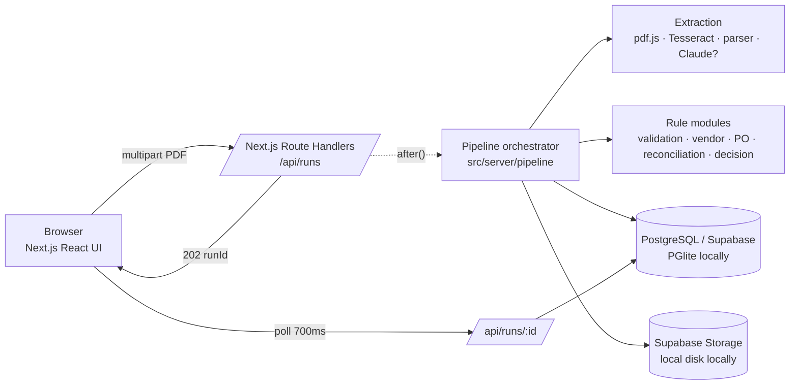
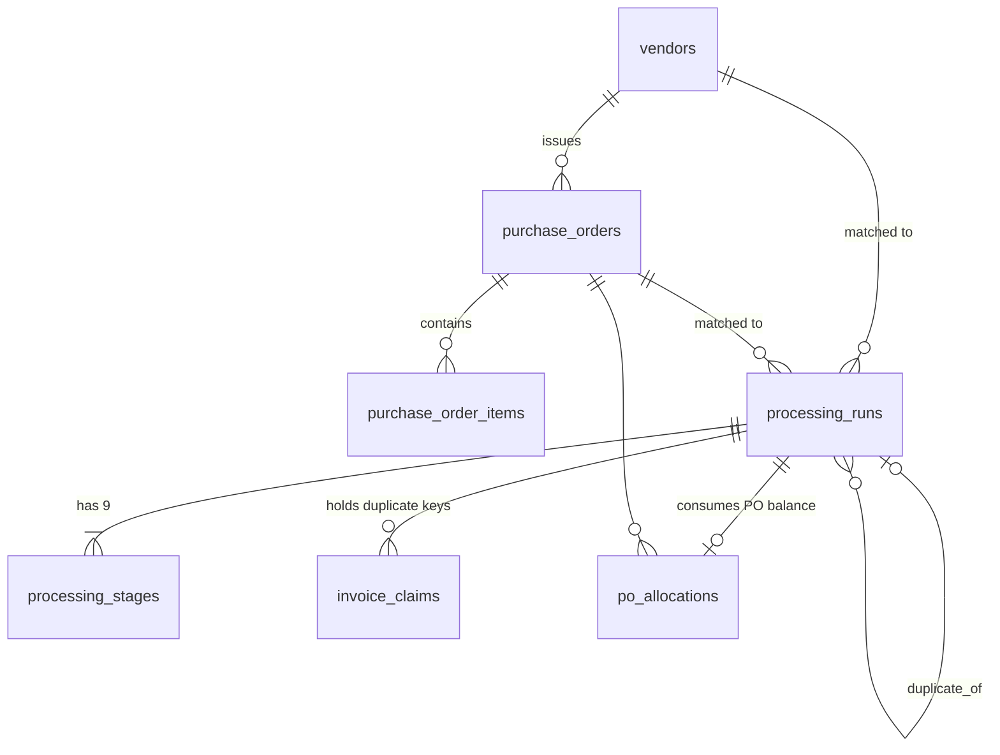

# InvoiceFlow AI

**Intelligent Accounts Payable Automation.** Upload a vendor invoice PDF and watch a nine-stage pipeline extract it, validate it, verify the vendor, catch duplicates, match it to a purchase order, reconcile the amounts and make an explained decision: **APPROVED**, **NEEDS_REVIEW** or **REJECTED**. Every stage, check and number is persisted and auditable.

> Built for the Zamp AI Solutions Analyst case study, Problem Statement 1 (Finance / AP: invoice processing).

---

## 1. Problem

A mid-size company receives hundreds of vendor invoices a month as PDFs. An AP clerk opens each one, finds the PO in a spreadsheet, checks whether the numbers line up, looks for duplicates and decides. The work is slow and repetitive, and mistakes are expensive: paying twice, paying an inactive vendor, or over-billing a PO.

Invoices are messy. Layouts differ by vendor, some are scans, PO references are sometimes missing, and sometimes the invoice number or date simply isn't there. Matching to a PO isn't always obvious, because vendors split POs across several invoices.

## 2. What InvoiceFlow does

| # | Stage | What actually runs |
|---|---|---|
| 1 | **Document ingestion** | Validates PDF header and size, creates the run, computes a SHA-256 fingerprint, stores the original in Supabase Storage (or local disk) |
| 2 | **Extraction** | pdf.js text layer with layout reconstruction → **Tesseract OCR** if the page is scanned → deterministic, layout-tolerant parser → *optional* Claude pass for low-confidence results (schema-validated and grounded in the document text) |
| 3 | **Validation** | Required fields, invoice-number format, date validity, currency allow-list, non-negative amounts, line math, subtotal, tax-rate math, total math, extraction confidence |
| 4 | **Vendor verification** | Match by tax ID → exact name → fuzzy name; checks existence, ACTIVE status, name and tax-ID consistency |
| 5 | **Duplicate detection** | Atomically *claims* `vendor + normalised invoice #` and `document fingerprint` with a UNIQUE constraint, which makes it race-free against completed **and** in-flight runs |
| 6 | **PO matching** | Explicit reference (with ownership check), else candidate search by vendor, currency, remaining balance and line-item similarity. Never auto-selects an ambiguous candidate |
| 7 | **Reconciliation** | Subtotal vs remaining PO balance (configurable tolerance, default 2%), cumulative invoiced vs PO total, currency, tax sanity, line-level price/qty comparison. Exact differences recorded |
| 8 | **Decision engine** | Deterministic rules → status + reasons. For approvals, the PO allocation is committed in a transaction under a `SELECT … FOR UPDATE` row lock with the balance re-checked |
| 9 | **Final output** | Full report persisted; downloadable as **PDF** and **JSON** |

The **live execution monitor** (`/runs/:id`) polls the persisted stage rows. It shows status, start/end time, duration, output, errors and the execution log for each stage. Refreshing the page recovers the run from the database.

### After the decision: vendor onboarding, vendor emails, audit trail

* **Add Vendor from the result page.** When verification finds no matching vendor, the report shows *Vendor not found* and a **+ Add Vendor** button. The dialog is prefilled from the invoice (name, address, tax ID; email and phone found in the document are flagged *verify*). Unavailable fields are marked for manual entry. Input is validated: required name, email format, Indian **GSTIN** format, contact number. Duplicates are blocked by tax ID or near-identical name, both in the service and by unique indexes.
* **Registration is not approval.** Vendors created from an invoice start as **Pending verification**. **Re-run verification & matching** creates a *new linked run* from the stored PDF and re-evaluates every stage. The original run, its stages and its decision are kept and marked *superseded*. A pending vendor fails `VENDOR_ACTIVE` with action REVIEW, so the invoice can't be approved until someone uses **Verify & activate** on the Vendors page and every other check passes.
* **Vendor communication.** **Draft Email to Vendor** builds a professional email from the run's actual decision, amounts, references and reasons. It covers four scenarios: rejected, needs review, missing information and approved, and approval emails never claim payment. Internal controls such as OCR confidence aren't presented as vendor errors. With `ANTHROPIC_API_KEY` set, **Draft with AI** polishes the wording, and the result is discarded if it introduces any amount, date or reference that isn't in the facts. The composer has editable To/CC/Subject/Body, **Copy Email** (plus subject-only and body-only copy), **Save draft**, and **Send Email**, which needs a confirmation dialog. Sending goes through a server endpoint to **Resend**. It's exactly-once (DRAFT→SENDING lock plus provider idempotency key) and is recorded as SENT only on provider acceptance. Failures are recorded as FAILED and can be retried. Without a provider, sending is disabled with an explanation and is never simulated.
* **Audit trail.** Vendor creation, re-processing, drafts, edits, sends and failures are appended to `run_events` and shown under *Activity & audit trail*. Email history (DRAFT / SENT / FAILED, recipient, subject, body, timestamps, provider message ID, error) is stored in `email_communications`.
* **Light / dark mode.** A sun/moon toggle sits in the sidebar (and mobile header) and in Settings. It persists per browser, an inline boot script prevents a flash of the wrong theme, and it defaults to the OS preference. Theming is centralised: Tailwind v4 compiles colors to CSS variables, so `.dark` remaps the palette and every page, chart, table, dialog and toast follows automatically.

## 3. Architecture



```
src/
  app/                 UI pages (Dashboard, Process, Run monitor, History, Vendors, POs, Settings) + API routes
  components/          Reusable UI (timeline, stage renderers, tables, badges)
  server/
    db/                Postgres (pg) or PGlite adapter, migrations runner
    storage/           Supabase Storage or local filesystem
    extraction/        pdf-text, OCR, deterministic parser, optional Claude extractor
    rules/             Pure, unit-tested business rules + deterministic decision engine
    repositories/      SQL data access (runs, stages, claims, allocations, master data, settings)
    pipeline/          Nine-stage orchestrator, retries, timeouts, failure recording
    reports/           JSON + PDF report generation
    seed/              Fictional vendors, POs, default business rules
db/migrations/         SQL migrations (run automatically, or `npm run db:migrate`)
db/seed-invoices/      Historical sample PDFs processed at seed time
public/samples/        Demo invoice PDFs (one-click load on the upload page)
tools/                 Invoice PDF generator (text + "scanned" image PDFs)
tests/                 Vitest unit + integration tests
```

Processing runs in the background via Next.js `after()`. The POST returns immediately with a run ID and the browser navigates to the live monitor. Each stage writes `RUNNING` before it executes and `COMPLETED`/`FAILED`/`SKIPPED` after, so the UI can never show a stage as done before the backend has finished it.

## 4. Technology stack

| Concern | Choice |
|---|---|
| App / API | Next.js 15 (App Router, route handlers), React 19, TypeScript, Tailwind CSS 4 |
| Database | PostgreSQL (Supabase) via `pg`; **PGlite** (real Postgres in WASM) for local dev/tests. Same SQL everywhere |
| Storage | Supabase Storage (private bucket, service-role key server-side only); local disk fallback |
| PDF text | `unpdf` (pdf.js) with positional line reconstruction |
| OCR | `tesseract.js` + bundled English model; pages rasterised with pdf.js + `@napi-rs/canvas` |
| AI (optional) | Anthropic Claude (`@anthropic-ai/sdk`), JSON-schema structured output, zod validation, grounding check |
| Charts / icons | Recharts, lucide-react |
| Reports | `pdf-lib` |
| Tests | Vitest (unit + full pipeline integration against PGlite) |

Why each was chosen: see **[docs/DESIGN_DECISIONS.md](docs/DESIGN_DECISIONS.md)**.

## 5. Database schema



* `vendors`: id, vendor_code (unique), vendor_name, vendor_tax_id, address, status `ACTIVE|INACTIVE`, …
* `purchase_orders`: id, po_number (unique), vendor_id → vendors, total_amount (net of tax), currency, status
* `purchase_order_items`: purchase_order_id → POs (cascade), description, quantity, unit_price, total_amount
* `processing_runs`: filename, file_path, file_fingerprint, extracted header fields, vendor_id, po_id, final_status, decision_reasons, decision (JSON), rules_snapshot, run_status, timings, attempt, is_sample
* `processing_stages`: run_id, stage_order (1–9, unique per run), stage_status, outcome, input_data, output_data, error_message, logs, started_at, completed_at, duration
* `invoice_claims`: **UNIQUE claim_key**. This is the concurrency-safe duplicate lock
* `po_allocations`: **UNIQUE run_id**, so a retry can never double-book. Written only for approvals, under a PO row lock
* `app_settings`: versioned business rules (JSON)
* `run_events`: append-only audit trail of post-processing actions per run
* `email_communications`: vendor emails per run (scenario, recipient, cc, subject, body, status `DRAFT|SENDING|SENT|FAILED`, provider message ID, error, idempotency key, timestamps)
* Migration `003` also adds vendor `PENDING_VERIFICATION` status, phone, payment details, source (`MANUAL|INVOICE|SEED`), `source_run_id`, `verified_at`, unique indexes on vendor name and normalised tax ID, and run lineage (`reprocessed_from_run_id`, `superseded_by_run_id`). Superseded runs stay in history but are excluded from KPIs
* View `purchase_order_balances`: invoiced amount and remaining balance per PO, always derived and never stored redundantly

Indexes cover run listing/sorting, status filters, fingerprint and (vendor, invoice#) lookups. Migration `002_security.sql` enables RLS on every table so Supabase's public REST API (anon key) can't read them. The app connects server-side as the table owner.

## 6. Business rules (defaults)

Full documentation: **[docs/BUSINESS_RULES.md](docs/BUSINESS_RULES.md)**. All rules are editable and validated on the Settings page. Each run stores a snapshot of the rules it used.

| Outcome | When |
|---|---|
| **REJECTED** (hard failures) | Duplicate invoice · vendor explicitly INACTIVE · PO belongs to a different vendor |
| **NEEDS_REVIEW** | Missing required field · arithmetic/tax mismatch · unknown vendor · tax-ID or name inconsistency · missing/unknown/ambiguous/inferred PO · amount over PO balance beyond tolerance · currency mismatch · extraction confidence < 70% · total > auto-approval limit (50,000) · PO balance consumed concurrently |
| **APPROVED** | Every check passes, PO matched explicitly, no review flags |

Principles: a missing PO never causes rejection on its own. A suspected duplicate is never ignored (it can be set to REJECT or REVIEW, but at least one detection method must stay on). AI never participates in the decision.

## 7. Demo scenarios (sample PDFs in `public/samples`)

| File | Scenario | Expected → verified |
|---|---|---|
| `01-apex-happy-path.pdf` | Clean text PDF, explicit PO | **APPROVED** |
| `02-nordic-scanned-ocr.pdf` | Image-only scan in EUR (OCR; corrects `P0O-…` → `PO-…`) | **APPROVED** |
| `03-apex-duplicate.pdf` | **Edge case 1**: re-sent invoice already processed | **REJECTED**, original run linked |
| `04-summit-amount-mismatch.pdf` | **Edge case 2**: $5,750 vs $4,500 remaining (+27.78%) | **NEEDS_REVIEW** |
| `05-brightline-missing-po.pdf` | **Edge case 3**: no PO, bundled line, two candidate POs | **NEEDS_REVIEW**, ambiguity explained |
| `06-orion-missing-fields.pdf` | **Edge case 4**: no invoice number or date | **NEEDS_REVIEW** |
| `07-meridian-inactive-vendor.pdf` | Vendor deactivated | **REJECTED** |
| `08-brightline-tax-error.pdf` | 8% tax stated, $300 charged (expected $240) | **NEEDS_REVIEW** |
| `09-brightline-partial-invoice.pdf` | Month 2 of a 12-month PO (cumulative tracking) | **APPROVED** |

Seeded history (processed through the real pipeline at first boot and tagged **Sample**) gives POs realistic prior invoicing, e.g. Apex INV-APX-2026-0398, which makes sample 03 a duplicate. Processing the same sample twice is itself caught as a duplicate. Use **Settings → Reset demo runs** to replay.

Suggested live-demo order: 01 (happy path) → 02 (scanned / OCR) → 03 (duplicate) → 04 (mismatch) → 05 (missing PO) → 06 (missing fields).

## 8. Running locally

Requirements: Node.js ≥ 20.9 (tested on Node 24). No database, Docker or API keys needed.

```bash
npm install
```

```bash
npm run dev
```

Open http://localhost:3000. On first boot the app migrates the embedded database and seeds vendors, POs and sample history (about 1 second).

Production mode:

```bash
npm run build
```

```bash
npm start
```

`npm start` runs the standalone server (`.next/standalone/server.js`). In local fallback mode its embedded database lives in `.next/standalone/.data` and is reset by each rebuild. Use `npm run dev` or `DATABASE_URL` for data that persists.

Useful scripts: `npm test`, `npm run typecheck`, `npm run lint`, `npm run db:migrate`, `npm run db:seed`, `npm run samples:generate` (regenerates the sample PDFs).

## 9. Environment variables

See **[.env.example](.env.example)**. All are optional and server-side only.

| Variable | Purpose | Default / fallback |
|---|---|---|
| `DATABASE_URL` | Postgres connection (Supabase **session pooler, port 5432**, or direct) | PGlite in `./.data/pglite` |
| `SUPABASE_URL`, `SUPABASE_SERVICE_ROLE_KEY` | Private document storage | local `./.data/uploads` |
| `SUPABASE_STORAGE_BUCKET` | Bucket name (auto-created, private, PDF-only) | `invoices` |
| `ANTHROPIC_API_KEY` | Enables Claude-assisted extraction for low-confidence documents | disabled; deterministic only |
| `ANTHROPIC_MODEL` | Claude model ID | `claude-opus-5-5` |
| `MAX_UPLOAD_MB` | Upload limit | 10 |
| `OCR_TIMEOUT_MS`, `AI_TIMEOUT_MS`, `RUN_TIMEOUT_MS` | Timeouts | 90s / 30s / 180s |
| `PIPELINE_STAGE_DELAY_MS` | Minimum visible time per stage in the live view (pacing only; real durations are shown) | 400 |
| `AUTO_SEED` | Seed on first boot | true |
| `RESEND_API_KEY`, `EMAIL_FROM` | Enable **Send Email** via Resend (`EMAIL_FROM` must use a verified domain) | not set: drafting and copy only, Send disabled |
| `EMAIL_REPLY_TO` | Reply-to address on vendor emails | none |
| `COMPANY_NAME` | Name used in email sign-offs | Contoso Manufacturing Corp. |

## 10. Deployment

OCR, background processing and SSE-free polling need a **long-running Node server**, so the target is a container host (Render, Railway, Fly.io) plus Supabase. Serverless also works through `after()`, but cold starts and OCR memory make it a worse fit.

**Supabase**
1. Create a project. Copy the **Session pooler** connection string (port 5432) to `DATABASE_URL`. Transactions and row locks are required, so don't use the transaction pooler on port 6543.
2. Copy the project URL and **service-role** key to `SUPABASE_URL` / `SUPABASE_SERVICE_ROLE_KEY`. The private `invoices` bucket is created automatically on first upload, or you can run `db/supabase/storage.sql`.
3. Run migrations and seed against it from your machine:

```bash
DATABASE_URL="postgresql://..." npm run db:migrate
```

```bash
DATABASE_URL="postgresql://..." SUPABASE_URL="https://..." SUPABASE_SERVICE_ROLE_KEY="..." npm run db:seed
```

(The server also auto-migrates and auto-seeds on first boot.)

**Render (Docker)**: push the repo to GitHub, then *New → Blueprint* and select the repo. `render.yaml` defines the service. Fill in the secret env vars in the dashboard. Health check: `/api/health`. Use at least the *Starter* plan (OCR needs about 512 MB RAM).

**Any Docker host**

```bash
docker build -t invoiceflow-ai .
```

```bash
docker run -p 3000:3000 --env-file .env invoiceflow-ai
```

Without `DATABASE_URL` the container falls back to PGlite inside the container. That's fine for a quick demo, but data is lost on redeploy, so use Supabase for a persistent live URL.

## 11. Testing

```bash
npm test
```

55 tests (Vitest), all against real PDFs and a real (embedded) Postgres:

* **Unit**: money/date/PO parsing, layout parsing, never inventing fields; validation (missing fields, tax math, totals, negatives, future dates, currencies); vendor matching (tax ID, fuzzy, unknown, inactive, tax-ID mismatch); PO matching (explicit, wrong owner, ambiguous, inferred, invalid ref); reconciliation (partial, tolerance boundary, exact differences, currency, configurable tolerance); decision precedence.
* **Vendor onboarding & email (integration)**: prefill from the invoice; pending vendor creation; duplicate blocking by name and tax ID; GSTIN/email validation; re-run creates a linked run, preserves and supersedes the original, and stays NEEDS_REVIEW while the vendor is pending; verified vendor passes vendor checks; KPIs don't double count. Email drafts for rejected (duplicate), needs-review (exact PO figures), missing-information and approved scenarios; draft editing and validation; no provider → refused and never simulated; mocked provider failure → FAILED; concurrent double-click sends exactly once → SENT with provider ID; sent emails locked; full audit sequence; AI grounding guard.
* **Integration (full 9-stage pipeline)**: 1 success · 2 duplicate with original run identified · same-file fingerprint duplicate · 3 amount mismatch · 4 missing PO / ambiguous · 5 missing invoice number & date · 6 unknown and inactive vendor · 7 incorrect tax · 8 scanned PDF via OCR · 9 multiple invoices against one PO · 10 **concurrent duplicate submissions** (3 at once → exactly one proceeds) · concurrent approvals can't over-allocate a PO · unreadable PDF recorded (not discarded) · invalid upload rejected · stale-run recovery + **safe retry** (no duplicate allocations) · settings validation + per-run rules snapshot · dashboard metrics update after a run · **history survives a restart** (file-backed DB reopened).

## 12. Known limitations

* The parser is tuned to common Western invoice conventions (English labels, `.`-decimal amounts; `,`-decimal is supported). Very unusual layouts fall back to review, or to Claude if a key is set.
* OCR is English-only and single-column oriented; low-quality scans lower confidence and go to review.
* PO balances are tracked at header level (net of tax). Line comparison flags price/qty variances but doesn't track per-line cumulative quantities (no goods-receipt / 3-way match).
* No FX conversion: a currency mismatch with the PO always needs review.
* No authentication or role-based approval UI. Review decisions are not actioned in-app.
* Email sending is implemented against Resend's API and tested with a mocked provider. It hasn't been exercised against the live service here (no API key available). Only plain-text emails are sent, with no attachments.
* Live updates use polling (700 ms), which works on every host. SSE/websockets would reduce load at scale.
* Demo pacing (`PIPELINE_STAGE_DELAY_MS`) holds each stage visible for at least 400 ms. Displayed durations are the real compute times.
* The Docker image and Supabase integration are implemented and documented, but were not exercised in this environment (no Docker or Supabase credentials available). The standalone production server was tested end to end locally.

## 13. Future improvements

Email/inbox ingestion · reviewer queue with approve/override + audit trail · 3-way match with goods receipts · per-line cumulative quantity tracking · FX rates · vendor-specific extraction templates learned from corrections · ERP export (NetSuite/SAP) · SSO and roles · SLA/ageing analytics · Slack notifications for review items.
